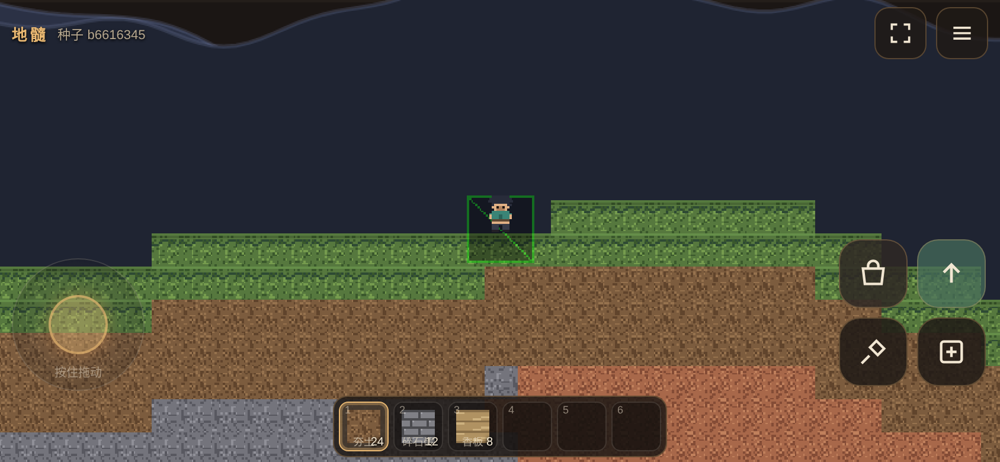
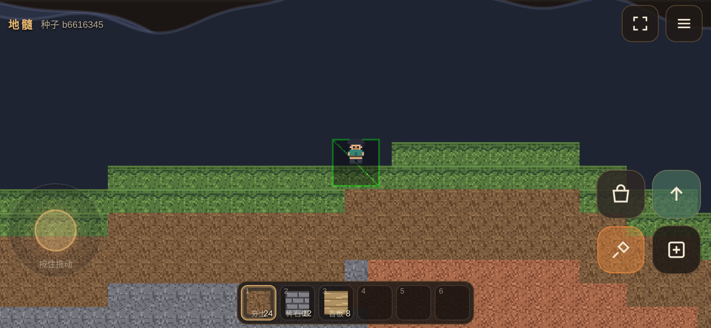
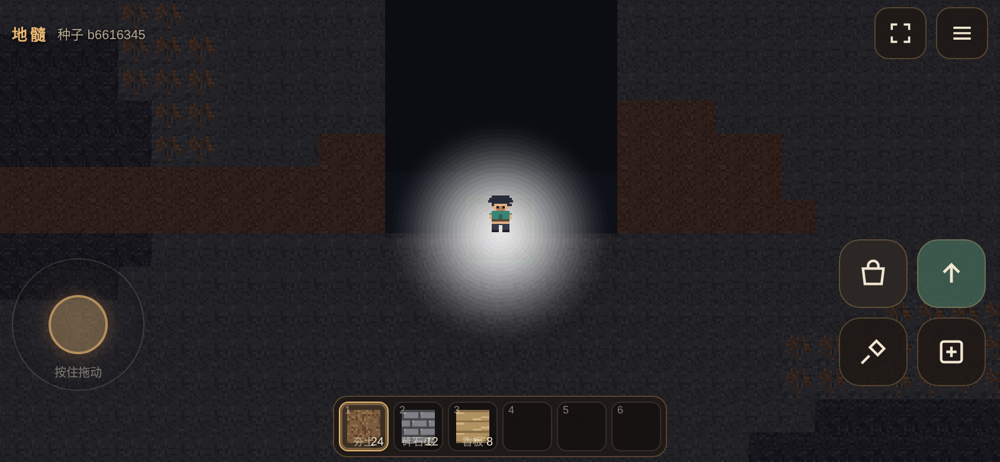
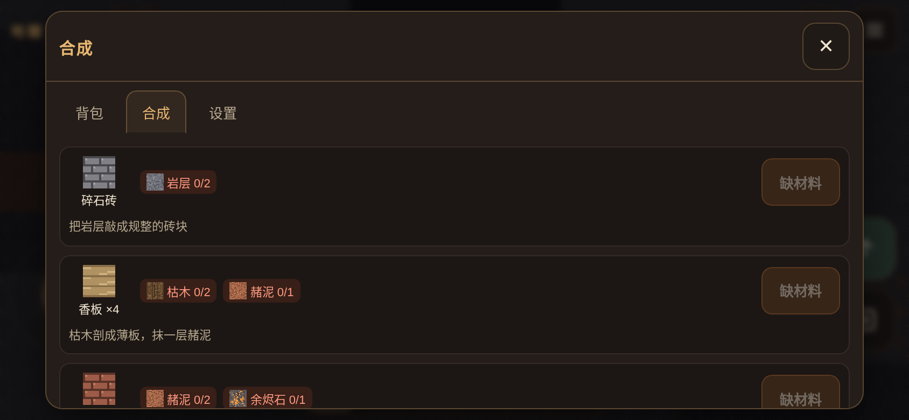

# 地髓 · Eartheno

> 手机横屏 2D 像素沙盒建造游戏。纯前端、可离线、可添加到桌面。
> 挖开地脉，把手边的碎石和赭泥攒成工具，再往下走。

**完全原创**：名称、美术、音效、配方均为本项目自制，使用 Canvas 程序化绘制，
**不含任何图片素材、不涉及任何第三方游戏商标或素材**。技术上受沙盒建造品类启发，
机制层面是独立的。

## 长什么样

| 地表 | 挖掘中 |
|---|---|
|  |  |

| 地下（自带光晕，越深越暗） | 基础合成 |
|---|---|
|  |  |

竖屏时不是硬裁画面，而是给一张明确的转屏提示：


> 截图由 `tools/shots.mjs` 在同一次构建上生成，分辨率 844×390 @2x（iPhone 14 横屏）。

---

## 快速开始

```bash
npm install
npm run dev        # http://localhost:5173
```

构建与本地预览（构建产物就是最终交付物，**纯静态**）：

```bash
npm run build      # tsc 检查 → vite build → tools/postbuild.mjs（注入 SW 预缓存 + 预算校验）
npm run preview    # http://localhost:4173
```

产物输出到 **`docs/`**（不是 `dist/`）。这是刻意选的：GitHub Pages 的
「Deploy from a branch」只允许仓库根目录或 `/docs` 作为发布源，产物直接放进去，
源码和可部署文件就能待在同一个仓库里互不打架。

如果部署在 GitHub **项目页**（`https://<用户名>.github.io/<仓库名>/`），用绝对 base 更稳：

```bash
GHP_BASE=/eartheno/ npm run build    # 换成你的仓库名
```

测试：

```bash
npm test           # Vitest 单元测试（128 个）
npm run test:e2e   # Playwright 端到端（29 个，会先 build 再跑）
npm run typecheck  # 只做类型检查
```

首次跑 E2E 需要下载浏览器：

```bash
npx playwright install chromium
```

---

## 玩法

| 操作 | 触屏 | 键盘（桌面调试） |
| --- | --- | --- |
| 移动 | 左下虚拟摇杆（可拖出摇杆范围，跟手） | `A` / `D` 或 `←` / `→` |
| 跳跃 | 右下 `↑` | `空格` / `W` / `↑` |
| 挖掘 | 右下镐子，**按住连续挖** | 按住 `S` / `Z` |
| 放置 | 右下 `＋` | `X` |
| 背包 | 左上背包键 | `E` |
| 快捷栏 | 底部 6 格 | `1`–`6` |

核心循环：**挖 → 攒材料 → 合成工具 → 挖更硬的层 → 合成更好的工具**。

- 手无寸铁只能挖苔土、夯土、枯木这类软料；
- 「碎石砖 + 枯木」做出**石镐**，才能啃动岩层；
- 岩层里有赭泥、燧石、铜脉；再往下是余烬石与青辉晶，需要**铜镐 / 青辉镐**；
- 越深越暗。照明靠**光晕**：角色自带一圈柔和光，手持工具/火把时光圈半径放大；暗度以海平面为基准计算，地表完全不压暗。

15 种方块、7 把工具、11 条配方。数值与配方表见 `src/core/blocks.ts` 与 `src/core/recipes.ts`，
两者都有单测兜底（配方引用的物品必须存在、产物必须可放置）。

---

## 技术要点

### 1. 确定性世界：只存档"被改动过的区块"

- 世界由 `seed` + 噪声完全决定：同一 `(seed, cx, cy)` 永远生成同样的 32×32 区块。
- 地形 = 2D 值噪声 + fBm，并对 fBm 输出做**对比度拉伸**——4 个 octave 叠出来的值
  集中在 0.37–0.58（±0.1），直接乘振幅地表只有 3 格起伏，画面上是一条俯视很"平"的长带。
- 洞穴用两层噪声的"等值线带"取交集，得到连续隧道而不是满天麻点；且强制在地表以下 8 格才开洞。
- 因此存档**只写被挖/被放的区块**，其余按种子即时重算。一个区块 1 KB，RLE + base64url 之后更小。

### 2. 自写 AABB 物理（不用 Arcade）

`src/core/physics.ts` 是一个不依赖 Phaser 的纯函数模块，可以直接单测：

- 分轴扫掠 + 子步推进（高速下落也不会穿薄地板）；
- **自动阶梯**：1 格高的台阶不用跳，直接走上去（先抬 y 再推 x，推不进去整体回滚）；
- coyote time（0.08s）+ jump buffer（0.1s）：手感的关键，没有这两样手机上手会想砸屏幕；
- `onGround` 只由 `settle()` 一处决定，避免"接触抖动"导致跳跃时有时无。

> 这里的 bug 特别多，`tests/unit/physics.test.ts` 的 11 个用例全是真实踩坑的回归。

### 3. 渲染：只画看得见的区块 + LRU

- 每个区块先画进一张离屏 Canvas（512×512），再作为一张纹理交给 Phaser；
  方块变了只重画对应的区块，不动主画布。
- 只创建视口 ±1 列、±1 行的视图；超出 `viewCap`（高画质 24 / 低画质 14）按 LRU 淘汰，
  同时 `textures.remove()` 释放显存。
- 全空区块不建视图——竖屏只看得见 1–2 行区块，这一条省掉一大半 Canvas 内存。
- 远景为三层视差山脊 + 天空渐变，全部用 Graphics 画，零图片。
- 自动降档：连续 3 次采样 < 40fps 就降一级画质（关粒子、关光照遮罩、缩视图上限），并 toast 告知。

### 4. 存档

- **IndexedDB**：三个 store（`meta` / `chunks` / `backups`）。
  - `chunks` 一条记录一个区块，按需读，不全量载入；
  - 写入 800ms 节流，`visibilitychange` / `pagehide` 强制 flush（移动端最容易丢档的就是切走那一刻）；
  - `meta` 每次写入前留备份，只保留 3 份，解析失败可回退。
- **localStorage**：设置（音量、音效、画质、长按间隔、FPS 显示、触感）。
  逐字段 `normalizeSettings` 重建 + `Number.isFinite` 守卫，坏数据不会把游戏打崩。
- **导出 / 导入**：存档编码为 `{app, fmt, ver, meta, chunks}` 的 JSON；`fmt`（格式版本）与
  `ver`（语义版本）分离。导入时逐字段重建、校验失败给出具体错误码
  （`NOT_JSON` / `NOT_EARTHENO` / `FMT_TOO_NEW` / `BAD_CHUNK` / `BAD_META`），不会把当前世界写坏。

### 5. 地下光照：把黑层"擦"出洞来

整屏铺一层黑（越深越暗，最深 0.86），再用 `destination-out` 在角色位置擦出一个径向渐变圆。
关键两件事：

- **擦除是乘性的**，所以每一圈必须按"当前还剩多少"逐圈反解 alpha（`α = 1 - 目标剩余/当前剩余`）。
  一圈一个固定 alpha 会叠出同心环；按面积份额硬叠又会累积到 1，变成纯白实心圆 —— 两个都踩过。
- **不要手算屏幕坐标**。`worldView` 是相机 preRender 里的缓存值，`update()` 时读到的是上一帧；
  正确做法是改用世界空间绘制（暗层不加 `scrollFactor(0)`），用 `getWorldPoint(0,0)` /
  `getWorldPoint(w,h)` 反查可见矩形，所有坐标都留在世界像素里。

> 相关回归：`tests/e2e/lighting.spec.ts`（地表不压暗 / 深处光圈在画布内 / 低画质关暗层）。

### 6. PWA

- `public/sw.js` 在构建时由 `tools/postbuild.mjs` 注入真实产物列表与构建号。
- 导航请求 **network-first**（保证能拿到新版本），静态资源 **stale-while-revalidate**；
  `version.json` 永远走网络，离线时给 `{}`。
- 更新策略：发现新 build → 顶部横幅提示「有新版本」→ 用户确认后 `skipWaiting` 并 reload。
  首次接管**不提示**（否则第一次打开就弹一个毫无意义的框）。
- `manifest.webmanifest`：`display: fullscreen` + `display_override`、`orientation: landscape`、
  maskable 图标。图标由 `tools/gen-icons.mjs` 用**手写 PNG 编码**（CRC32 + zlib deflate）生成，
  不引入任何图片处理依赖。

---

## 目录

```
src/
  core/            纯逻辑，无 Phaser 依赖，全部可单测
    rng.ts         种子化 PRNG（hash32 + mulberry32 + rngAt，与抽取顺序无关）
    noise.ts       2D 值噪声 / fBm
    terrain.ts     地形、洞穴、矿脉、出生点
    blocks.ts      16 种方块定义（含 air）
    recipes.ts     7 把工具 + 11 条配方
    inventory.ts   背包 / 快捷栏 / 合成
    physics.ts     AABB 移动、跳跃、自动阶梯
    save.ts        存档编解码（RLE + base64url）、meta 逐字段重建
    settings.ts    设置归一化
  art/             程序化像素画（字符串画稿 → Uint8ClampedArray）
  game/
    GameScene.ts   场景：相机、区块渲染、挖掘/放置、粒子、HUD 数据
    world.ts       世界状态（chunk 缓存 + dirty 集合）
    viewport.ts    视口与朝向（含 400ms 轮询兜底）
    audio.ts       WebAudio 程序化音效（无音频文件）
  persistence/     IndexedDB、导入导出
  ui/              HUD / 摇杆 / 面板 / 样式
  main.ts          启动编排、帧循环、输入桥接
public/
  sw.js            Service Worker 模板（构建时注入）
  manifest.webmanifest
  icons/           构建时由 tools/gen-icons.mjs 生成
tools/
  gen-icons.mjs    手写 PNG 编码生成图标
  postbuild.mjs    构建号 / 预缓存注入 / 清理旧产物 / 体积预算
  shots.mjs        生成 screenshots/ 下的预览截图（需先 build + preview）
tests/
  unit/            Vitest
  e2e/             Playwright
docs/            **构建产物**（GitHub Pages 的发布源，提交进仓库）
screenshots/     README 用的截图
```

---

## 已知边界

- 单人本地，**没有**账号、云存档、多人联机、生物 AI（MVP 明确不做）。
- 世界横向约 ±4096 格，纵向到底有界石；越界返还界石（挖不动），不会掉出世界。
- 音效为 WebAudio 实时合成，iOS 需要首次触摸后才能出声（已在首次手势里 unlock）。
- 低画质下会关闭地下暗部遮罩与部分粒子，观感略平，但帧率优先。

## 许可

代码与美术均为本项目原创。可自由用于学习与二次开发，请勿将「地髓 / Eartheno」作为他人作品发布。
